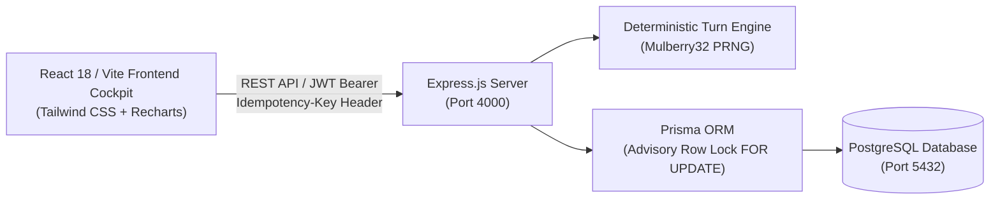

# ScaleUp — Founder Simulation Engine

**Team:** T0027  
**Academic Course:** Advanced Programming (AP 2026)  
**Database:** PostgreSQL 16+ / 18+ with Prisma ORM  
**Architecture:** Express.js REST API + Pure Deterministic Simulation Engine + React (Vite) Frontend Cockpit  

---

## Overview

**ScaleUp** is a full-stack founder simulation platform. Founders start at **Month 0** with **$500,000** in seed capital, 100% equity, and navigate monthly economic cycles by setting pricing, hiring/firing across 4 roles, allocating marketing spend, and reacting to seeded deterministic market events (viral tweets, outages, enterprise contracts).

---

## System Architecture



---

## Completed Features (Frontend & Backend Integration)

| # | Requirement | Status | Implementation Details |
|---|-------------|--------|------------------------|
| **1** | **Registration & Login** | Completed | Full auth flow with JWT token issued upon registration/login, bcrypt (12 rounds) hashing, form validation, and quick-fill test credentials. |
| **2** | **Authentication State** | Completed | React `AuthContext` persisting JWT token and founder profile in `localStorage`. Centralized 401 interceptor that clears session and redirects to login. |
| **3** | **Protected Pages** | Completed | `ProtectedRoute` wrapper guarding all private views (`/dashboard`, `/decisions`, `/employees`, `/analytics`, `/history`). Redirects unauthorized attempts to `/login`. |
| **4** | **Startup Creation** | Completed | Modal and empty-state onboarding to create a new venture with name and deterministic RNG seed (Mulberry32). |
| **5** | **Startup Dashboard** | Completed | Founder cockpit displaying active status, current month counter, VC term sheet alerts, executive metric grid, and recent market developments. |
| **6** | **Financial Metrics** | Completed | BigInt integer cents formatted into `$`, `ARR`, `MRR`, `Net Burn`, `Runway (months)`, `Product Quality (1-100)`, and `Founder Equity (basis points)`. |
| **7** | **Monthly Decision Interface** | Completed | Turn cockpit: product price adjustment, marketing spend across 3 channels with live lead estimates, hiring/firing controls, term sheet acceptance, and pre-flight expense calculator. |
| **8** | **Employee Management** | Completed | Team roster with headcount breakdowns for `ENGINEERING`, `SALES`, `MARKETING`, and `SUPPORT`. Total monthly payroll tracking and alumni history. |
| **9** | **Customer Analytics** | Completed | Cohort retention table, churn mechanics diagnostic (base churn, quality modifier, support modifier, price elasticity), and marketing conversion rates. |
| **10** | **Turn History & Ledger** | Completed | Monthly turn archive with historical snapshots, decisions applied, market events, and double-entry general ledger entries (INFLOW, OUTFLOW, NET). |
| **11** | **Charts & Visualizations** | Completed | Recharts time-series area charts for Cash & MRR growth, and bar charts for Revenue vs Expenses comparison. |
| **12** | **States (Loading, Error, Bankrupt, Empty)** | Completed | Loading skeletons, friendly error alerts with retry guidance, empty state for new founders, and Chapter 11 bankruptcy game-over screen with restart option. |

---

## API Contract Summary (Coordinated with Backend Lead)

All monetary amounts are stored and communicated as **integer cents** (e.g. `$49.00 = 4900`).  
All equity and percentages are stored as **integer basis points** (e.g. `20.00% = 2000 bps`, `100.00% = 10000 bps`).

### 1. `POST /api/v1/auth/register`
- **Request Body:** `{ "name": "Alex", "email": "founder@scaleup.io", "password": "password123" }`
- **Response (201):** `{ "token": "...", "user": { "id": "...", "name": "...", "email": "..." } }`

### 2. `POST /api/v1/auth/login`
- **Request Body:** `{ "email": "founder@scaleup.io", "password": "password123" }`
- **Response (200):** `{ "token": "...", "user": { ... } }`

### 3. `GET /api/v1/startups`
- **Headers:** `Authorization: Bearer <token>`
- **Response (200):** Array of startups belonging to the authenticated founder.

### 4. `POST /api/v1/startups`
- **Headers:** `Authorization: Bearer <token>`
- **Request Body:** `{ "name": "Acme SaaS", "seed": 42 }`
- **Response (201):** Newly created startup initialized at Month 0 with $500,000 cash.

### 5. `GET /api/v1/startups/:id`
- **Headers:** `Authorization: Bearer <token>`
- **Response (200):** Full startup state including `employees`, `cohorts`, `turns`, and `availableTermSheet`.

### 6. `POST /api/v1/startups/:id/turns`
- **Headers:**
  - `Authorization: Bearer <token>`
  - `Idempotency-Key: <uuid>` *(Required: guarantees exactly-once execution)*
- **Request Body:**
  ```json
  {
    "priceCents": 4900,
    "marketing": { "organic": 100000, "paid": 200000, "content": 50000 },
    "hires": [ { "role": "ENGINEERING", "count": 2 } ],
    "fires": [],
    "acceptTermSheet": false
  }
  ```
- **Response (200):** `{ "turn": { ... }, "state": { ... }, "events": [ ... ], "ledger": [ ... ], "availableTermSheet": ... }`
- **Safety:** Backend executes inside interactive PostgreSQL transaction with `SELECT id FROM "Startup" WHERE id = $1::uuid FOR UPDATE` preventing race conditions or double-advances.

---

## How to Run the Frontend and Backend Together

### Prerequisites
1. **Node.js**: v18+ (tested on Node v24)
2. **PostgreSQL**: PostgreSQL 15, 16, or 18 (e.g. via Postgres.app, Docker, or native service)

---

### Step 1: Database Setup
Ensure PostgreSQL is running and create the `scaleup` database:
```bash
# Using psql:
psql -d postgres -c "CREATE DATABASE scaleup;"
```
*(Or use Docker: `docker-compose up -d`)*

---

### Step 2: Configure & Start the Backend
Navigate to the `backend/` directory:
```bash
cd backend

# 1. Install dependencies
npm install

# 2. Configure environment variables in backend/.env:
# DATABASE_URL="postgresql://<user>:<password>@localhost:5432/scaleup"
# PORT=4000
# JWT_SECRET="scaleup-secret"

# 3. Apply Prisma database migrations
npm run db:push

# 4. Start the backend API server (runs on http://localhost:4000)
npm run dev
```

---

### Step 3: Configure & Start the Frontend
In a new terminal, navigate to the `frontend/` directory:
```bash
cd frontend

# 1. Install frontend dependencies
npm install

# 2. Start the Vite development server (runs on http://localhost:3000)
npm run dev
```

Vite proxies `/api` calls directly to `http://localhost:4000`, so no manual CORS or environment overrides are required.

Open your browser at:  
👉 **`http://localhost:3000`**

---

## Running Automated Tests

Run the frontend test suite with Vitest:
```bash
cd frontend
npm run test
```
The test suite validates:
- Login and registration workflows
- Authentication state persistence and unauthorized route guards
- Startup initialization and dashboard rendering
- Monthly decision submission and idempotency key delivery
- Turn execution and financial metric updates
- Error boundaries and invalid request rejection
